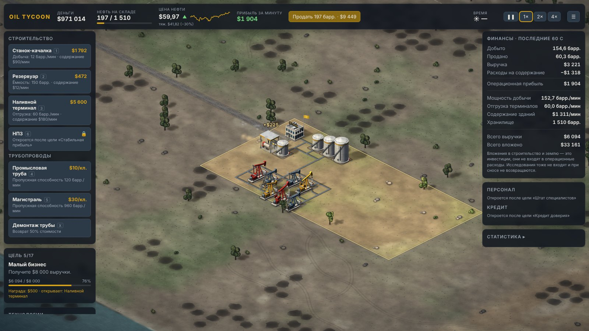
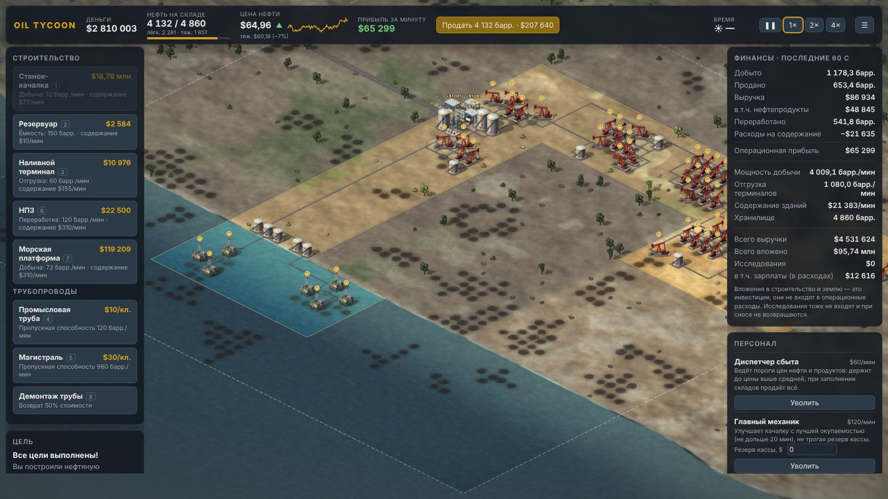
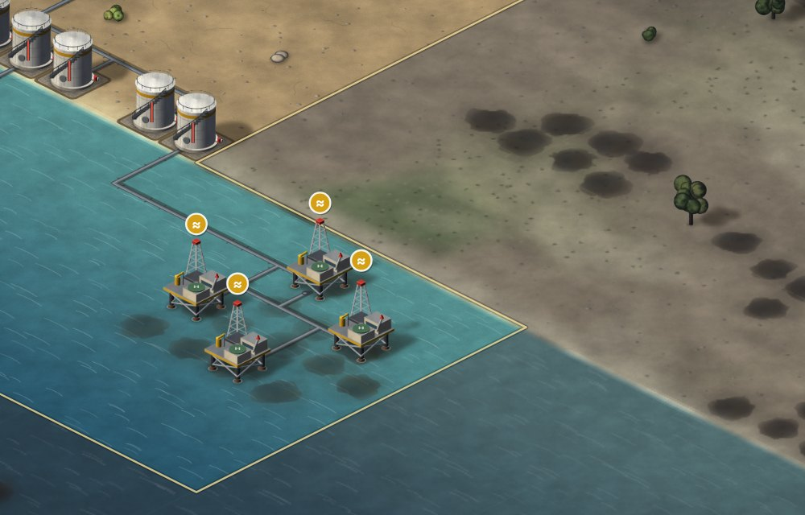
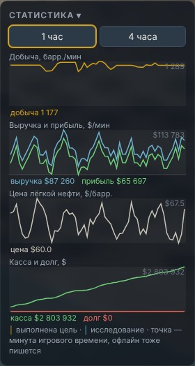
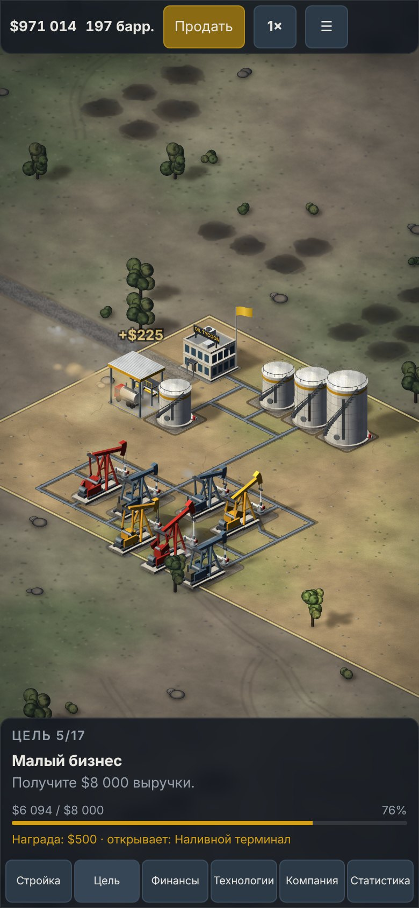
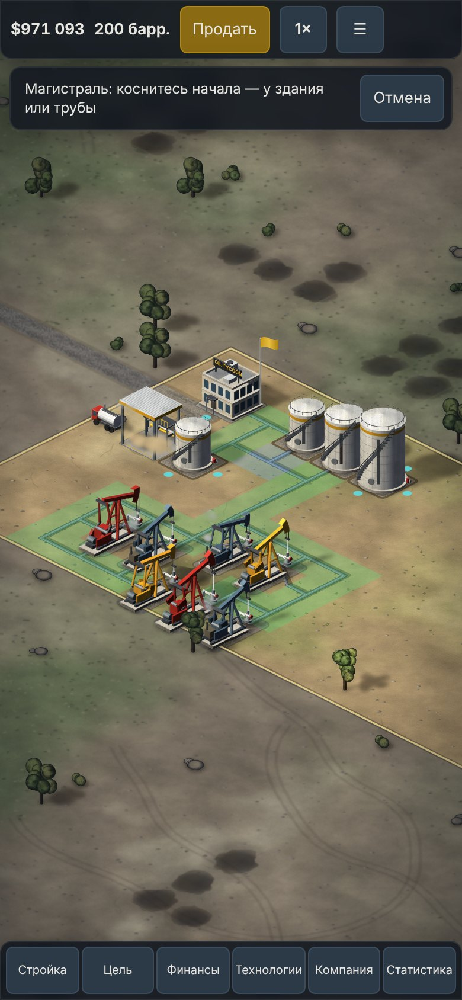

# Oil Tycoon

Изометрическая экономическая стратегия: от одной скважины до нефтяной империи.
Работает в браузере на компьютере и телефоне, без установки; можно поставить как приложение (PWA).



## Что есть в игре

- **Добыча и логистика.** Станки-качалки на месторождениях, трубы с пропускной способностью (промысловые и магистрали), резервуары, наливные терминалы, ручная продажа перекупщику.
- **Рынок и сорта.** Цена нефти колеблется; тяжёлая нефть дешевле, но её месторождения крупнее; резервуар хранит один сорт.
- **Земля и разведка.** Соседние участки покупаются; запасы чужой земли видны только после геологической съёмки и сейсморазведки.
- **НПЗ.** Переработка в бензин, дизель и мазут со своими ценами — «продать сырьё или переработать».
- **Компания.** Исследования (4 технологии по 3 уровня), персонал (диспетчер сбыта, главный механик), кредит.
- **Регионы.** Карта 56×56: степь, **пустыня** на востоке (крупные месторождения тяжёлой нефти, дешёвая земля) и **шельф** на юге — **морские платформы** и трубы по морю.
- **Статистика** за 1 и 4 часа с отметками целей и исследований, **процедурный звук** и музыка.
- **Офлайн-прогресс:** промысел работает, пока вас нет (до 4 часов). Сохранение — автоматически.



| Морские платформы на шельфе | Статистика |
|---|---|
|  |  |

### На телефоне

| Нижний лист с вкладками | Труба двумя касаниями |
|---|---|
|  |  |

## Запуск

Нужен Node.js 20.19+ (требование Vite 7).

```bash
npm install
npm run dev          # режим разработки: http://localhost:5173
```

Открыть с телефона в той же сети: `npm run dev -- --host` и адрес вида `http://192.168.x.x:5173`.

## Все команды

| Команда | Что делает |
|---|---|
| `npm run dev` | Сервер разработки с перезагрузкой, `http://localhost:5173` (`-- --host` — доступ из локальной сети) |
| `npm run build` | Проверка типов и сборка в `dist/` (вместе с service worker для офлайн-запуска) |
| `npm run preview` | Запуск собранной `dist/` локально, `http://localhost:4173` |
| `npm run typecheck` | Только проверка типов TypeScript |
| `npm test` | Тесты ядра: симуляция, логистика, деньги, сохранения и миграции, регионы, платформа, статистика |
| `BALANCE_LOG=1 npm test` | То же плюс отчёты баланса: бот проходит игру на 5 картах (темп целей, рост добычи за 180 мин, НПЗ). Долго — несколько минут |
| `npx vitest run tests/regions.test.ts` | Один файл тестов (любой из `tests/`) |
| `npm run test:mobile` | Мобильный бот-тестировщик: проходит путь новичка на экране 390×844 только касаниями и проверяет, что всё в экране и доступно пальцем |
| `npx playwright install chromium` | Один раз перед `test:mobile` (или укажите свой Chromium в `CHROMIUM_PATH`) |

Собранную папку `dist/` можно выложить на любой статический хостинг (пути относительные).

## Параметры адреса

| Адрес | Что открывает |
|---|---|
| `/?demo` | Демо-сцена с готовым промыслом (настоящее сохранение не трогает) |
| `/?late` | Поздняя игра: ~90 зданий, пустыня, шельф, платформы — для проверки производительности |
| `/?perf` | Счётчик кадров/с, времени кадра и памяти на экране (можно вместе: `/?late&perf`) |
| `/?platform=yandex` | Принудительно загрузить SDK «Яндекс Игр» (облачное сохранение, реклама за награду) |

## Управление

**Компьютер:** перетаскивание мышью или стрелки — камера, колесо — масштаб, щелчок — выбор здания или участка.

| Клавиша | Действие |
|---|---|
| `1` | Станок-качалка |
| `2` | Резервуар |
| `3` | Наливной терминал |
| `6` | НПЗ |
| `7` | Морская платформа (шельф) |
| `4` / `5` | Промысловая труба / магистраль — протяните мышью от здания или трубы |
| `X` | Демонтаж трубы |
| `S` | Продать нефть перекупщику (−20% к рынку) |
| `Пробел` | Пауза |
| `Esc`, правая кнопка | Отмена |
| Кнопки ❚❚ / 1× / 2× / 4× | Скорость игры |

**Телефон:** один палец — камера, два пальца — масштаб, касание — выбор. Здания и трубы — на вкладке «Стройка»:
- здание — касание клетки и кнопка «Построить»;
- труба — касание начала, касание конца и «Проложить»;
- полоса сверху подсказывает, что делать, и отменяет режим.

Скорость — кнопка `1×` в верхней строке, звук и громкость — в меню `☰`.

## Как играть

1. Поставьте **станок-качалку** на тёмное пятно месторождения и подключите её **трубой** к конторе (или кнопкой «Подключить» у качалки).
2. Продавайте нефть вручную, затем поставьте **резервуары** и **наливной терминал** — он продаёт сам и по полной цене.
3. Покупайте и разведывайте соседнюю землю, улучшайте здания, следите за узкими местами труб (значок ≈).
4. Цепочка целей открывает НПЗ, кредит, исследования, персонал, а затем пустыню и шельф.

## Документация

- [docs/PROJECT.md](docs/PROJECT.md) — исходная концепция проекта.
- [docs/DESIGN.md](docs/DESIGN.md) — игровой дизайн: механики, экономика, баланс.
- [docs/ARCHITECTURE.md](docs/ARCHITECTURE.md) — технологии и устройство кода.
- [docs/ART.md](docs/ART.md) — художественное направление и устройство графики.
- [docs/ROADMAP.md](docs/ROADMAP.md) — план развития, известные ограничения и технический долг.
- [docs/DECISIONS.md](docs/DECISIONS.md) — журнал решений и всех изменённых чисел баланса.
