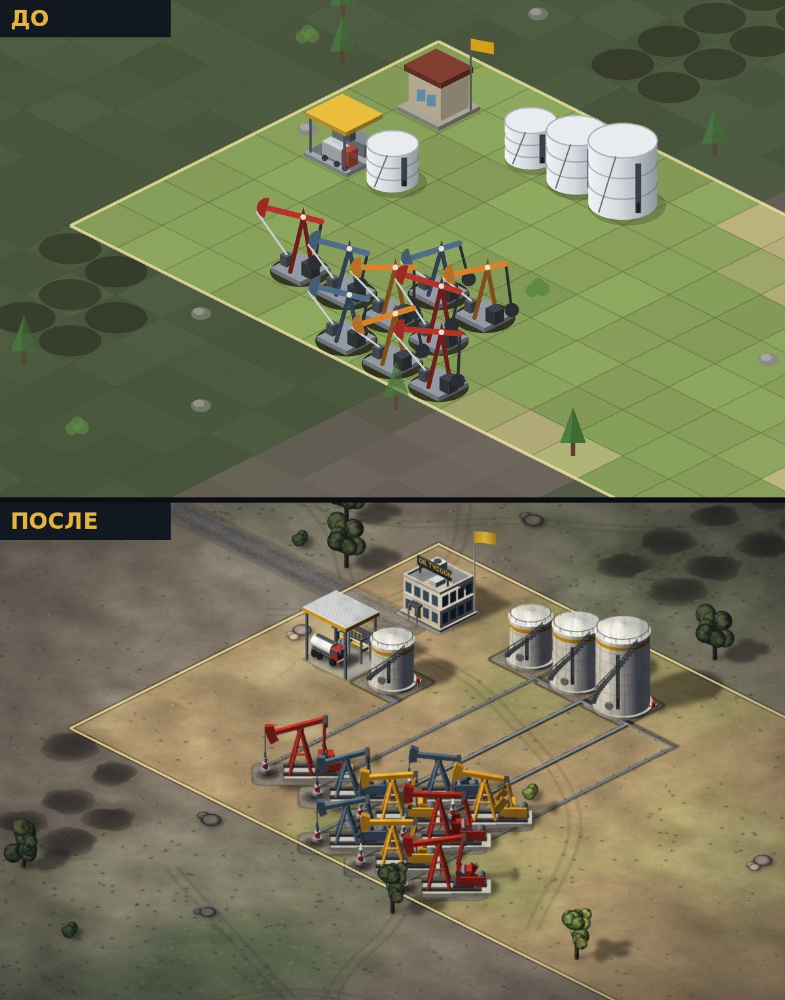

# Графика: художественное направление и устройство

## Почему старая графика выглядела схематично

| Проблема | Причина в коде (версия 0.1) |
|---|---|
| Земля — «шахматная доска» | Каждая клетка заливалась одним цветом с обводкой; швы и сетка неизбежны. |
| Качалка — плоский значок | Рисовалась линиями в плоскости экрана, без объёма и материалов. |
| Здания — коробки | Три грани с фиксированными коэффициентами яркости, без модели освещения. |
| Нет «веса» | Тени — один размытый эллипс, нет контактного затемнения. |
| Месторождения — одинаковые овалы | Один эллипс на клетку. |

## Художественное направление

**Стилизованный реализм промышленной степи.** Тёплый сухой грунт, белая сталь резервуаров, крашеная техника,
оцинкованные трубы, бетон и гравий. Объекты должны читаться как настоящее оборудование, но оставаться
понятными в экономической стратегии: чёткие силуэты, узнаваемые цвета уровней (качалка: серо-синяя → оранжевая → красная).

- **Единый свет**: солнце слева-спереди-сверху (`LIGHT` в `src/render/model.ts`). Правые грани (+x) в тени, левые (+y) освещены, тени падают вправо.
- **Единый масштаб**: 1 клетка ≈ одна промышленная площадка; высота в тех же единицах, что и клетка (1 ед. = 39,2 px).
- **Материалы**: цвет + сила и резкость блика (`MATERIALS`). Сверху — текстура загрязнения (multiply).
- **Цвета интерфейса и мира не спорят**: золотой `#d4a017` — фирменный цвет и в HUD, и на поясах резервуаров, навесе, флаге.

## Технический подход

Выбран **Canvas 2D + процедурное запекание**, а не PixiJS/WebGL и не готовые растровые ассеты:

- карта небольшая (40×40 клеток, сотни объектов) — после запекания кадр состоит из ~150 вызовов `drawImage`, это быстро и без WebGL;
- готовых ассетов в едином стиле нет, а случайный набор картинок нарушил бы единство света и масштаба;
- процедурные модели гарантируют общий свет, масштаб и материалы у всех объектов и легко расширяются;
- рендер по-прежнему только читает `GameState`, поэтому переход на PixiJS в будущем не затронет симуляцию: спрайты — обычные холсты, их можно загрузить как текстуры.

### Слои кадра

1. **Подложка карты** — срез грунта по краям (мир выглядит как макет).
2. **Земля** — запекается по участкам 8×8 в уже спроецированный холст:
   процедурная текстура (шум, рельефная светотень, трава, камешки, трещины, колеи техники) → пятна нефти
   (бледнеют при истощении) → дороги → площадки зданий → трубопроводы → **статичные тени** → затемнение чужой земли.
   Куски перекрываются с одинаковым содержимым, поэтому швов нет. Кусок перепекается, только когда меняется
   его содержимое (не больше одного за кадр, устаревший показывается до готовности нового).
3. **Динамические тени** — у качалок (кадр анимации) и движущихся бензовозов.
4. **Объекты** — запечённые спрайты, сортировка по глубине `x + y`. Терминал разбит на «заднюю» и «переднюю»
   части, чтобы бензовоз заезжал под навес.
5. **Динамика поверх**: указатель уровня на резервуарах, флаг, значки состояния, всплывающий текст.
6. **Виньетка** — CSS поверх холста.

### Модели (`src/render/model.ts`, `src/render/models.ts`)

`ModelPainter` рисует 3D-примитивы в изометрии: `box`, `obox` (повёрнутый), `cylinder`, `cone`, `tube`,
`sphere` (в т.ч. эллипсоид и «листва»), `wire`, `planeText`. Для каждой грани считается освещение по нормали
(небесный эмбиент + солнце + блик Блинна — Фонга), невидимые грани отбрасываются, у основания — затемнение (AO).
Каждый примитив сам добавляет свою проекцию в список теней.

`bakeSprite` сначала измеряет модель, затем рисует её в холст в 2× разрешении и накладывает текстуру загрязнения.
Станок-качалка запекается в 48 кадров цикла с честной кинематикой: кривошип → шатун → балансир → канатная подвеска.

### Как добавить новый объект

1. Написать функцию модели в `models.ts` из примитивов (дальние детали — первыми).
2. Добавить метод в `SpriteLibrary` (`sprites.ts`) с ключом кеша.
3. Добавить ветку в `Renderer.buildingParts` (как рисовать) и `buildingSprites` (чья тень запекается в землю).
4. При необходимости — площадку в `GroundDecals.drawPad`.
5. Проверить на демо-сцене `?demo` и снять скриншот через Playwright.

## Производительность

Замеры в headless Chromium без GPU (худший случай), окно 1440×860:

| Версия | FPS | JS на кадр |
|---|---|---|
| 0.1 (плоская графика) | 56 | ~1 мс |
| Новая графика | 47–53 | 0,5–0,7 мс |

Разовые затраты: кусок земли ~60 мс (при загрузке), кадр качалки ~1,2 мс (лениво), перепекание куска после
постройки ~15–40 мс (по одному за кадр). Память: земля ≈ 60 МБ на всю карту 40×40.

## Тени

Каждый примитив модели сам добавляет свою проекцию на землю вдоль `LIGHT`; из этого списка запекается маленькая
размытая картинка тени (`bakeShadow` в `renderer.ts`). Есть два вида фигур:

- **падающая тень** — проекция детали, плотность 0,72;
- **контактная тень** — основание детали, стоящей на земле (фундаменты, днища резервуаров, устья, валуны), плотность 1:
  у основания объект «садится» на землю, дальше тень светлее.

Вертикальные грани у земли (в т.ч. у повёрнутых деталей) затемняются градиентом (AO).

Статичные тени (резервуары, терминал, контора, декор) запекаются в землю: внутри куска они сливаются без двойного
затемнения и ничего не стоят в кадре.

**Тень качалки динамическая.** Сравнивались варианты:

| Подход | Цена в кадре | Итог |
|---|---|---|
| Пересчёт векторных теней всех качалок в общем слое | ~23 мс (программный рендер) | дорого |
| Перепекание земли под качалкой | ~15 мс на кусок | дорого |
| Статичная часть в земле + подвижная отдельно | мало, но двойное затемнение на стыке | артефакты |
| **Запечённая тень для каждого из 48 кадров анимации** | 1 `drawImage` на качалку (~0,06 мс на все) | выбрано |

Тень кадра строится из тех же примитивов и той же кинематики (кривошип → шатун → балансир), что и модель, —
отдельной анимации тени нет. Солнце светит слева-спереди, поэтому тень балансира падает назад-вправо и частично
закрыта самой качалкой; заметнее всего движется полоса тени балансира с «головой».

## Композиция качалок

Модель качалки вдоль своей оси занимает ~1,15 клетки и помещается в диагональ клетки (1,41), поэтому соседи по
той же диагонали не пересекаются. Перекрытия давали соседи по стороне клетки: они смещены всего на 32 px по горизонтали,
и «головы» с редукторами переплетались. Уменьшать модель не стали — это ухудшило бы читаемость. Вместо этого введено
игровое правило интервала между скважинами (соседи по стороне запрещены, по диагонали — разрешены) и зона дренирования,
чтобы экономика не пострадала. Диагональный сосед стоит строго впереди/позади и корректно сортируется по глубине.
При размещении и при выборе качалки зона подсвечивается.

## Известные ограничения

- Тени не падают на другие объекты (только на землю); динамическая тень качалки, наложенная на запечённую тень соседа, даёт лёгкое двойное затемнение.
- Нет смены времени суток, частиц (дым, пыль) и звука.
- Земля одной биомы (степь); рельеф только светотенью, без настоящих перепадов высот.
- При сильном приближении (>2×) на HiDPI земля слегка мягче объектов (запечена в 1,5×).
