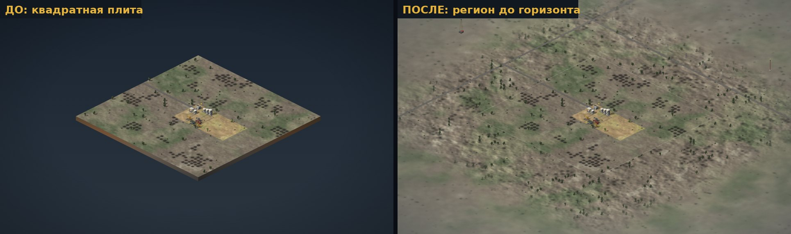
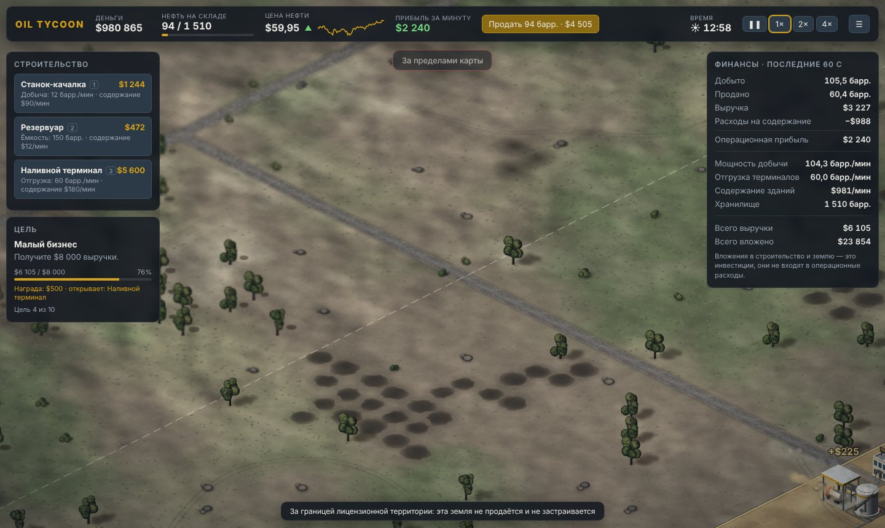
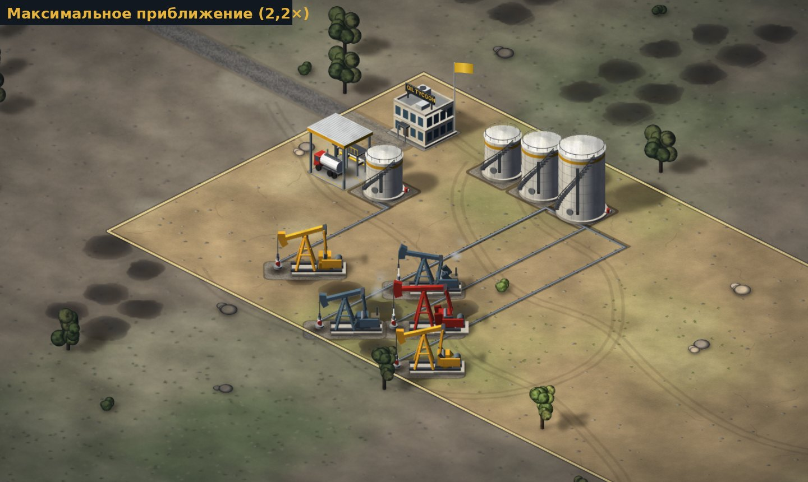
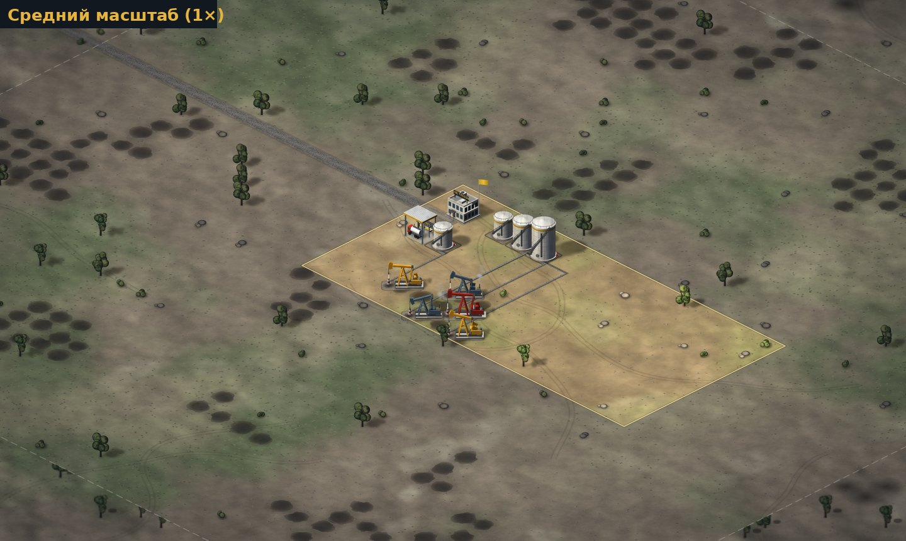
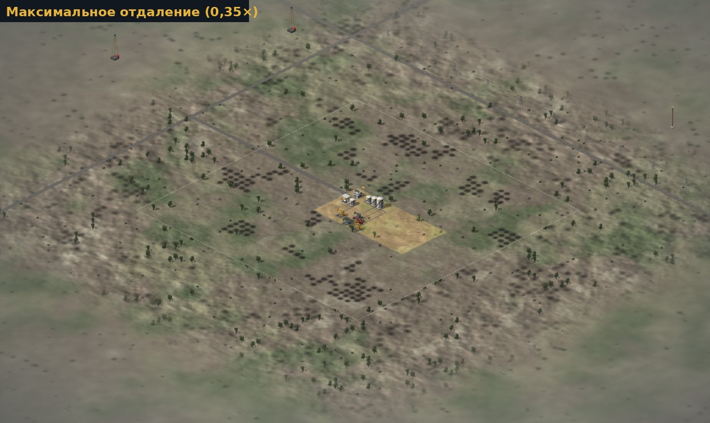
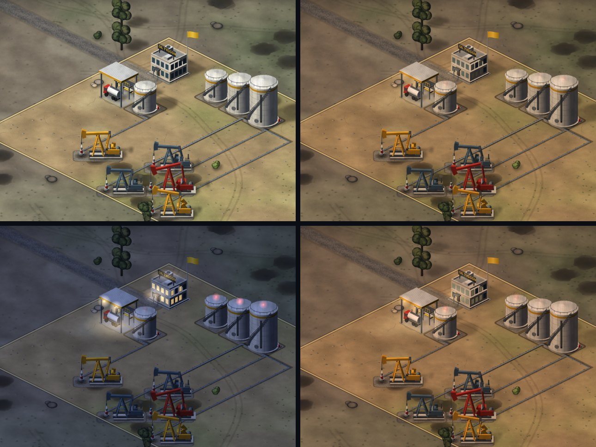
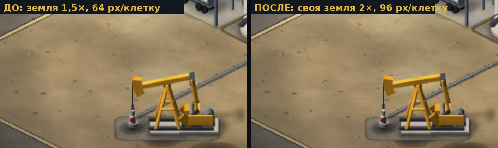

# Графика: художественное направление и устройство

## Почему старая графика выглядела схематично

| Проблема | Причина в коде (версия 0.1) |
|---|---|
| Земля — «шахматная доска» | Каждая клетка заливалась одним цветом с обводкой; швы и сетка неизбежны. |
| Качалка — плоский значок | Рисовалась линиями в плоскости экрана, без объёма и материалов. |
| Здания — коробки | Три грани с фиксированными коэффициентами яркости, без модели освещения. |
| Нет «веса» | Тени — один размытый эллипс, нет контактного затемнения. |
| Месторождения — одинаковые овалы | Один эллипс на клетку. |

## Художественное направление

**Стилизованный реализм промышленной степи.** Тёплый сухой грунт, белая сталь резервуаров, крашеная техника,
оцинкованные трубы, бетон и гравий. Объекты должны читаться как настоящее оборудование, но оставаться
понятными в экономической стратегии: чёткие силуэты, узнаваемые цвета уровней (качалка: серо-синяя → оранжевая → красная).

- **Единый свет**: солнце слева-спереди-сверху (`LIGHT` в `src/render/model.ts`). Правые грани (+x) в тени, левые (+y) освещены, тени падают вправо.
- **Единый масштаб**: 1 клетка ≈ одна промышленная площадка; высота в тех же единицах, что и клетка (1 ед. = 39,2 px).
- **Материалы**: цвет + сила и резкость блика (`MATERIALS`). Сверху — текстура загрязнения (multiply).
- **Цвета интерфейса и мира не спорят**: золотой `#d4a017` — фирменный цвет и в HUD, и на поясах резервуаров, навесе, флаге.

## Технический подход

Выбран **Canvas 2D + процедурное запекание**, а не PixiJS/WebGL и не готовые растровые ассеты:

- карта небольшая (40×40 клеток, сотни объектов) — после запекания кадр состоит из ~150 вызовов `drawImage`, это быстро и без WebGL;
- готовых ассетов в едином стиле нет, а случайный набор картинок нарушил бы единство света и масштаба;
- процедурные модели гарантируют общий свет, масштаб и материалы у всех объектов и легко расширяются;
- рендер по-прежнему только читает `GameState`, поэтому переход на PixiJS в будущем не затронет симуляцию: спрайты — обычные холсты, их можно загрузить как текстуры.

### Слои кадра

1. **Окружение** (см. «Большой мир»): фон цвета дымки → дальняя текстура до горизонта → ячейки степи →
   ориентиры (буровые, факел, ЛЭП). Пропускается целиком, если весь экран над игровой картой.
2. **Земля** — запекается ячейками 4×4 клетки в уже спроецированный холст:
   процедурная текстура (шум, рельефная светотень, трава, камешки, трещины, колеи техники) → пятна нефти
   (бледнеют при истощении) → дороги → площадки зданий → трубопроводы → затемнение чужой земли.
   Трубопроводы рисуются по клеткам `map.pipes`:
   - каждая клетка тянет половинки отрезков к соседним трубам и отводы к зданиям (к качалке — до устья);
   - на опорах-шпалах, с тенью и бликом;
   - у примыкания к хранилищу — фланец, на конце линии — заглушка;
   - магистраль в 1,7 раза толще.

   Ключ ячейки включает типы труб в ней и вокруг. Слой загрузки сети и предпросмотр прокладки рисуются
   поверх запечённой земли каждый кадр, их цвета — интерфейсные.
   Ячейки перекрываются на 0,06 клетки с одинаковым содержимым, поэтому швов нет. Ячейка перепекается, только
   когда меняется её содержимое (не больше одной за кадр, в начале кадра и в новый холст; устаревшая показывается
   до готовности новой).
   Ключ содержимого ячейки (строка: владение, пятна, здания, трассы) не строится каждый кадр: раз за кадр считается
   числовая подпись строения мира (здания, свои участки, разведка, трубы); при её смене ключи сбрасываются,
   иначе ключ ячейки обновляется раз в 8 кадров — пятна нефти бледнеют медленно (веха 0.5: на карте 56×56
   пересчёт ключей всех видимых ячеек занимал до 2,5 мс кадра при отдалении).
   **Статичные тени** — отдельный слой у каждой ячейки (тени объектов, стоящих в ней, холст по габаритам теней);
   выводится с прозрачностью по времени суток.
3. **Динамические тени** — у качалок (кадр анимации) и движущихся бензовозов.
4. **Объекты** — запечённые спрайты, сортировка по глубине `x + y`. Терминал разбит на «заднюю» и «переднюю»
   части, чтобы бензовоз заезжал под навес.
5. **Частицы**: пыль сортируется по глубине вместе с объектами, дым и выхлоп рисуются поверх них.
6. **Время суток**: цветокоррекция кадра (multiply) и искусственный свет (additive), см. ниже.
7. **Динамика поверх**: указатель уровня на резервуарах, флаг, значки состояния, всплывающий текст (не темнеют ночью).
8. **Виньетка** — CSS поверх холста.

### Модели (`src/render/model.ts`, `src/render/models.ts`)

`ModelPainter` рисует 3D-примитивы в изометрии: `box`, `obox` (повёрнутый), `cylinder`, `cone`, `tube`,
`sphere` (в т.ч. эллипсоид и «листва»), `wire`, `planeText`. Для каждой грани считается освещение по нормали
(небесный эмбиент + солнце + блик Блинна — Фонга), невидимые грани отбрасываются, у основания — затемнение (AO).
Каждый примитив сам добавляет свою проекцию в список теней.

`bakeSprite` сначала измеряет модель, затем рисует её в холст в 2× разрешении и накладывает текстуру загрязнения.
Станок-качалка запекается в 48 кадров цикла с честной кинематикой: кривошип → шатун → балансир → канатная подвеска.

**Морская платформа** (веха 0.5, `models.platform`): четыре ноги опорного блока из воды с раскосами, жёлтая
палуба, решётчатая вышка с красным кронблоком; 2-й уровень — технологический модуль и кран, 3-й — жилой блок
с вертолётной площадкой и факельная стрела. Площадки нет: под ногами — пена и тёмный отлив (`GroundDecals.drawPad`).
Море и пляж — в той же процедурной текстуре земли (`terrain.ts`, `seaWeight`): на карте берег идёт ровно по границе
шельфа, за краями карты изгибается; на воде вместо камней и травы — гребешки волн.

**Дороги и бензовозы.** Дороги визуальные и идут строго по осям одной полосой (`ROAD_X`, `ROAD_Y` в `ground.ts`): главная — ряд перед конторой с запада, короткий подъезд от двери конторы, к каждому терминалу — ответвление, найденное с штрафом за поворот (прямо, где можно; обычно один поворот). Бензовоз — одна модель в четырёх направлениях (`models.truckDir`, поворот на 90° и отражение). Бензовоз терминала грузится под навесом кабиной к выезду, затем едет по своему ответвлению на главную дорогу и по ней на запад; грузовик перекупщика (ручная продажа) — от двери конторы по подъезду на главную дорогу. Пыль, выхлоп и ночные фары берутся из той же модели и следуют за машиной.

### Как добавить новый объект

1. Написать функцию модели в `models.ts` из примитивов (дальние детали — первыми).
2. Добавить метод в `SpriteLibrary` (`sprites.ts`) с ключом кеша.
3. Добавить ветку в `Renderer.buildingParts` (как рисовать) и `buildingSprites` (чья тень запекается в землю).
4. При необходимости — площадку в `GroundDecals.drawPad`.
5. Проверить на демо-сцене `?demo` и снять скриншот через Playwright.

## Производительность

Замеры в headless Chromium без GPU (худший случай), окно 1440×860:

| Версия | FPS | JS на кадр |
|---|---|---|
| 0.1 (плоская графика) | 56 | ~1 мс |
| Новая графика | 47–53 | 0,5–0,7 мс |

Разовые затраты: ячейка земли высокого качества ~17 мс, низкого ~9 мс (при загрузке и покупке земли),
кадр качалки ~1,2 мс (лениво), перепекание ячейки после постройки ~3–6 мс (по одной за кадр).
Подробнее — раздел «Память и перепекание».

## Тени

Каждый примитив модели сам добавляет свою проекцию на землю вдоль `LIGHT`; из этого списка запекается маленькая
размытая картинка тени (`bakeShadow` в `renderer.ts`). Есть два вида фигур:

- **падающая тень** — проекция детали, плотность 0,72;
- **контактная тень** — основание детали, стоящей на земле (фундаменты, днища резервуаров, устья, валуны), плотность 1:
  у основания объект «садится» на землю, дальше тень светлее.

Вертикальные грани у земли (в т.ч. у повёрнутых деталей) затемняются градиентом (AO).

Статичные тени (резервуары, терминал, контора, декор) запекаются в слой теней ячейки: каждая тень рисуется ровно
один раз (в ячейке своего объекта), внутри слоя тени сливаются без двойного затемнения, а сила слоя меняется
со временем суток без перепекания.

**Тень качалки динамическая.** Сравнивались варианты:

| Подход | Цена в кадре | Итог |
|---|---|---|
| Пересчёт векторных теней всех качалок в общем слое | ~23 мс (программный рендер) | дорого |
| Перепекание земли под качалкой | ~15 мс на кусок | дорого |
| Статичная часть в земле + подвижная отдельно | мало, но двойное затемнение на стыке | артефакты |
| **Запечённая тень для каждого из 48 кадров анимации** | 1 `drawImage` на качалку (~0,06 мс на все) | выбрано |

Тень кадра строится из тех же примитивов и той же кинематики (кривошип → шатун → балансир), что и модель, —
отдельной анимации тени нет. Солнце светит слева-спереди, поэтому тень балансира падает назад-вправо и частично
закрыта самой качалкой; заметнее всего движется полоса тени балансира с «головой».

## Частицы (`src/render/particles.ts`)

Отдельный динамический слой: на землю не влияет и перепекания не вызывает.

- Пул на типизированных массивах, ёмкость 480; при переполнении вытесняются старейшие частицы, в кадре нет выделений памяти.
- Время — игровое: на паузе частицы замирают, на ×4 живут вчетверо быстрее (испускание — на игровую секунду).
- Адаптивное качество: если реальный кадр медленнее 30 / 20 кадров/с, испускание снижается до 60% / 35%.
- Вариативность: 4 запечённых варианта «клубов» из нескольких мягких пятен на вид, случайные размер, время жизни,
  скорость; медленно меняющийся ветер и турбулентность.
- Кто испускает и почему:
  - **бензовозы** — пыль из-под задних колёс при движении (сильнее с ростом скорости) и дизельный выхлоп из трубы;
  - **качалки 1-го уровня** — у старых станков газовый двигатель (в модели появились блок цилиндров и выхлопная труба):
    тонкий постоянный выхлоп и клуб на каждом ходе, привязанный к фазе кривошипа;
  - **качалки 2–3-го уровня** — электродвигатели, без дыма (заодно визуально отличаются уровни).
- Машины уезжают по свободной стороне: если по оси x за терминалом или конторой стоят здания, бензовоз выезжает
  в обратную сторону (зеркальная модель), а если заперт с обеих — растворяется на месте.

Замеры (headless Chromium без GPU, 1440×860): обычная игра — 0,8 мс JS на кадр, ~50 кадров/с;
нагрузочный тест (×4 и продажа каждые 10 кадров, пул заполнен до 480) — 1,6 мс (p95 2,2 мс), ~43 кадра/с.

## Большой мир и адаптивная детализация (`src/render/environment.ts`)

Игровая карта (40×40) больше не плита на тёмном фоне: вокруг неё визуальный регион ~280×280 клеток,
который игровая симуляция не видит.

| Зона | Охват | Как сделано | Разрешение |
|---|---|---|---|
| **Ближняя** — промысел | игровая карта | прежние ячейки 4×4 + объекты | своя земля 2×, чужая 1× |
| **Средняя** — степь | кольцо 24 клетки вокруг карты | ячейки 8×8 в проекции; кусты, камни и рощи **запечены в текстуру** вместе с тенями; редкие нефтепроявления, колеи, региональные дороги | 0,6× у карты (32 px/клетку), 0,32× дальше (12 px) |
| **Дальняя** — панорама | до ~140 клеток от центра | одна текстура в координатах клеток: та же палитра и шум, пологие увалы (амплитуда растёт с расстоянием), растительность — тёмными точками | 3 px/клетку, ~2,8 МБ |

- **Без швов**: шум земли — функция мировых координат, поэтому карта, степь и панорама продолжают друг друга.
  Внешний край кольца степи плавно растворяется в дальней текстуре (маска 10 клеток).
- **Дымка** — одна радиальная функция расстояния от центра карты (прозрачна над игровой территорией, к ~90 клеткам
  сливается с фоном). Запечена в дальнюю текстуру, ячейки степи и спрайты ориентиров — в кадре ничего не стоит.
  Фон экрана того же цвета, поэтому края мира не видно; ночью всё вместе темнеет общей цветокоррекцией.
- **Ориентиры**: чужие буровые вышки и факельная установка (пламя мерцает, ночью светится) — далеко за границей и
  в дымке, по виду не похожи на активы игрока; ЛЭП с провисающими проводами вдоль региональной дороги за картой.
  Все стоят позади или далеко сбоку от карты, поэтому рисуются до объектов игрока и никогда их не перекрывают.
  Купола-«холмы» пробовались и отброшены: в ортографической изометрии они выглядели плоскими «блинами» —
  рельеф передан светотенью дальней текстуры.
- **Камера** не уходит дальше 8 клеток за край карты, поэтому пустоты за миром не видно ни при каком положении.

### Правила строительства не изменились

Земля за картой выглядит так же, как непроданные участки (то же затемнение), а граница лицензионной территории
отмечена пунктиром. При наведении — подсказка «За границей лицензионной территории: эта земля не продаётся и не
застраивается»; щелчок ничего не выбирает, строительство там невозможно (проверено в браузере).

### Адаптивная детализация

| Приём | Зачем |
|---|---|
| **Мип-копии** спрайтов и ячеек земли (½, ¼, ⅛; `mipmap.ts`) | холст 2× при отдалении сжимается в 6–10 раз — тонкие детали мерцали; заранее отфильтрованная копия убирает мерцание и экономит заполнение. Создаются лениво (не больше 8 за кадр), освобождаются через ~10 с без использования |
| Растительность степи запечена в текстуру, вдали — точки | вдали деревья «объединяются», в кадре — одна картинка на ячейку |
| Частицы плавно перестают испускаться при отдалении | их всё равно не видно |
| Окружение не рисуется, когда экран целиком над картой | приближение не платит за дальние слои |
| Дальняя текстура растрируется только снаружи плотной части степи | меньше заполнения |
| Генерация земли в **Web Worker** (`terrain.worker.ts`, OffscreenCanvas → ImageBitmap) | шум, пиксели, трава — вне основного потока; без поддержки — синхронно |
| Фоновая подготовка в спокойных кадрах | невидимые ячейки карты, дальняя текстура (по кускам строк) и степь готовы до отдаления камеры; новые ячейки проявляются плавно |

### Три масштаба одной сцены

### Замеры (headless Chromium без GPU, 1440×860, демо-сцена, медиана 3 прогонов)

| | До | После |
|---|---|---|
| Кадров/с: приближение 2,2× | 54,7 | 58,3 |
| Кадров/с: 1× | 60,3 | 60,3 |
| Кадров/с: отдаление 0,35× | 60,3 | 57,0 |
| JS на кадр | 1,0–1,2 мс | 1,0–1,7 мс |
| Память холстов после отдаления | 37,6 МБ | 59,2 МБ (из них мип-копии 8,4) |
| Память через 10 с после возврата к приближению | 37,6 МБ | 50,9 МБ |
| Проход масштаба 2,2× → 0,35× за 2 с: худший кадр / p95 JS | — | 18 / 4,8 мс |
| Фоновая подготовка после загрузки | — | ~3 с, кадры ≤ 32 мс JS |
| Покупка участка: JS кадра | 25–47 мс | ≤ 8 мс (генерация в Worker) |

Визуальная площадь выросла примерно в 49 раз, память — на 13–22 МБ.

Путь к этим цифрам (что не сработало):
- первая дальняя текстура считала освещение по клеткам грубой сетки — «пиксельные» блоки; исправлено интерполяцией;
- проход масштаба сначала давал кадры до 92 мс: дальняя текстура (173 мс) и ячейки пеклись при первом появлении.
  Дальняя текстура стала генерироваться кусками в спокойных кадрах, ячейки — заранее;
- ячейка степи у карты стоила до 64 мс: дорогое сглаживание «high» при сжатии спрайтов (заменено мип-копиями)
  и слишком частая сетка шума (для степи — 1/8 клетки вместо 1/16);
- окончательно подтормаживания сняты переносом генерации текстуры в Web Worker.

## Смена дня и ночи (`src/render/daylight.ts`)

Спрайты и земля запечены при дневном солнце, поэтому полноценное динамическое освещение потребовало бы перепекать
сотни холстов спрайтов и всю землю при каждом изменении света (или хранить 3–4 комплекта и смешивать их — ×3–4 памяти
и вдвое больше рисования). Выбран компромисс, который ничего не перепекает:

| Составляющая | Как сделано | Цена |
|---|---|---|
| Освещённость и цветовая температура | один полноэкранный проход `multiply` цветом по ключевым точкам: рассвет тёплый, день нейтральный (проход пропускается), «золотой час», сумерки, ночь синеватая с ограничением яркости снизу | 1 заливка |
| Сила теней | статичные тени — отдельный слой ячеек, выводится с прозрачностью; динамические — тот же множитель. Ночью тени почти исчезают | бесплатно |
| Искусственный свет | аддитивные световые пятна: прожекторы и световое пятно у терминала, окна и вход конторы, вывеска, мигающие заградительные огни резервуаров, фары уезжающих бензовозов. Позиции берутся из моделей (`LIGHTS`, `HQ_WINDOWS`) | десятки `drawImage` |

- Время суток выводится из `GameState.time`: следует скорости игры, останавливается на паузе, предсказуемо
  восстанавливается из сохранения и идёт во время офлайн-прогресса. Структура сохранения не менялась.
- Сутки — 10 минут игры на ×1, игра начинается в 08:00. Часы — в верхней панели; в меню есть выключатель
  «Смена дня и ночи» (настройка хранится в браузере; выключено — всегда полдень).
- Интерфейс — DOM поверх холста, ночью не темнеет; значки состояния и всплывающий текст рисуются после цветокоррекции.
- Направление солнца не меняется в течение дня — осознанное упрощение.

Замеры (headless Chromium без GPU, 1440×860): день ~46–49 кадров/с, ночь ~44–47; JS 1,2–1,3 мс на кадр.

## Память и перепекание

Исследованы три ограничения прошлой версии. Замеры — сумма холстов по `renderer.memoryStats()` после обхода всей
карты 40×40 на демо-сцене; кадры — реальные интервалы `requestAnimationFrame` после постройки резервуара.

| Показатель | До | После |
|---|---|---|
| Память холстов, всего | 77,2 МБ | 37,6 МБ |
| — исходная текстура земли | 26,6 МБ (вся карта) | 7,6 МБ (только своя земля и соседние ячейки) |
| — запечённая земля | 36,5 МБ (всё в 1,5×) | 17 МБ (своя 2×, чужая 1×) |
| — тени земли | в составе земли | 0,4 МБ (холсты по габаритам теней) |
| Кадры после постройки | 49, 41, 33 мс, затем ~22 | 21, 20, 21, 22 мс — без всплесков |
| Земля при максимальном приближении | 1,5×, 64 px на клетку | своя земля 2×, 96 px на клетку |

Что сделано и почему помогло:

- **Ячейки 4×4 вместо участков 8×8** — постройка затрагивает вчетверо меньшую площадь.
- **Уровни качества**: своя земля (её разглядывают при приближении) — 2× и 96 px на клетку; чужая (затемнена) — 1× и 48 px.
- **Освобождение исходников**: текстура чужой земли, далёкой от своей, освобождается сразу после запекания.
  Ячейки рядом со своей землёй исходник сохраняют — именно их меняют площадки, трубы и тени у границы
  (первоначально исходник освобождался везде, и перепекание соседних чужих ячеек стоило ~44 мс на генерацию).
- **Перепекание в начале кадра и в новый холст**: перезапись холста, уже нарисованного в текущем кадре,
  вынуждает браузер дорисовать кадр заранее.
- **Тени по габаритам**: первый вариант слоя теней с запасом 1,6 клетки вокруг каждой ячейки покрывал экран
  ~3 раза с альфа-смешиванием и уронил частоту до 21 кадра/с — холст подогнан под реальные тени.
- **Мелкий шум земли** считается на сетке ~1/32 клетки с интерполяцией: генерация ячейки высокого качества
  ~17 мс вместо ~40.

## Композиция качалок и планировка промысла

**Что создавало перекрытия.** Измерено по запечённым спрайтам (альфа > 40, все кадры, пиксели мира от центра клетки):

| Уровень | Ширина на экране | Высота |
|---|---|---|
| 1 | 54 px (−24…+30) | ~45 px |
| 2 | 58 px | ~48 px |
| 3 | 64 px (−28…+36) | ~52 px |

Клетка — 64×32 px. Вдоль балансира станок занимает 1,2–1,4 клетки, поперёк — ~0,45. Основание и опоры не шире модели.
Кашу давала не геометрия деталей, а направление: балансир шёл по горизонтали экрана (диагональ клетки).
- Соседи по стороне смещены всего на 32 px по горизонтали, поэтому «голова» одного станка ложилась на редуктор другого — «лесенка».
- Сосед по диагонали вправо стоит в 64 px — встык, чисто.
- Сосед по диагонали вниз стоит в 32 px ниже и закрывает основание заднего.

**Решение — ряды с поворотом станков.** Ориентация модели задаётся осями профиля (`models.ts`, `AXES`); запечённые спрайты кешируются по ориентации.
- 0 — одиночная качалка: прежний профиль, балансир по горизонтали экрана.
- 2 — качалка в ряду вдоль оси x: балансир вдоль y.
- 1 — качалка в ряду вдоль оси y: балансир вдоль x.

Соседи по стороне в ряду стоят параллельно, в клетке друг от друга. Узкая поперечная сторона (~0,45 клетки) оставляет просвет, поэтому балансиры и «головы» каждого станка читаются отдельно — как на кустовой площадке.
- Во всех ориентациях «голова» дальше от зрителя, чем двигатель, а поперечная ось смотрит к зрителю, поэтому порядок рисования «сначала дальние детали» верен.
- Ориентация не хранится, а выводится из расстановки (`pumpOrientAt`). Сменив её, качалка коротко «подпрыгивает».
- Призрак при размещении показывает, как развернутся соседи.
- Площадка под станком вытянута вдоль балансира, отвод трубы идёт к устью в его фактическом положении.

Отвергнутые варианты:
- уменьшить модель на 25–30%, чтобы станки вставали встык: теряется силуэт;
- увеличить клетку: ломает сетку, участки, дренирование и сохранения;
- ориентация вдоль ряда (балансиры встык): перекрытие «голова — двигатель» осталось.

Ориентиры при размещении: точки на клетках, где качалку можно поставить, и зелёные ромбики там, где она продолжит ряд.
Сравнительные кадры (до, старая плотная расстановка, после) лежат в рабочей папке сессии.

## Известные ограничения

- Тени не падают на другие объекты (только на землю); динамическая тень качалки, наложенная на запечённую тень соседа, даёт лёгкое двойное затемнение.
- Нет звука. Частицы не отбрасывают теней; дым не взаимодействует с объектами.
- Земля одной биомы (степь); рельеф только светотенью, без настоящих перепадов высот.
- Окружение — экспериментальная первая версия: ориентиров немного и они расставлены вручную, дороги прямые,
  в ортографической проекции нет настоящего горизонта (его заменяет дымка).
- Первые ~3 с после загрузки идёт фоновая подготовка земли и степи (кадры до ~30 мс в программном рендере).
- Средняя зона по ширине ограничена 24 клетками; дальше — только грубая панорама.
- Чужая земля при сильном приближении мягче своей (запечена в 1×) — сознательная экономия памяти.
- Солнце не движется по небу: меняются только цвет, яркость и сила теней.
